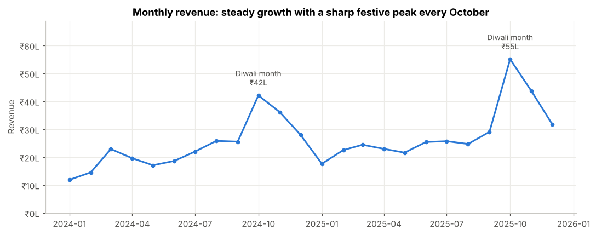
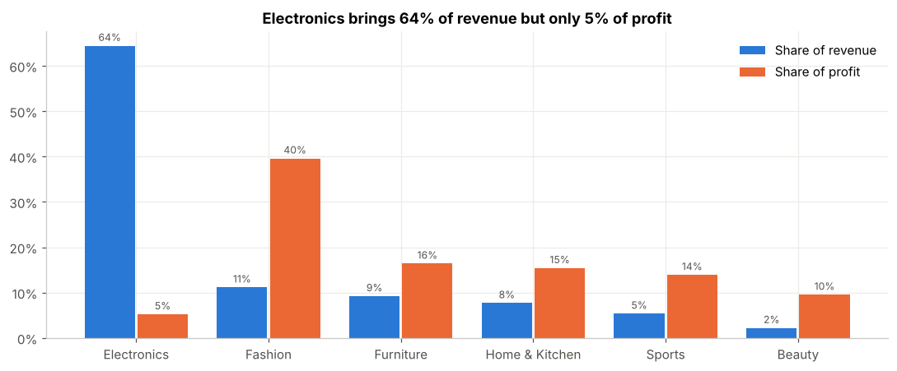
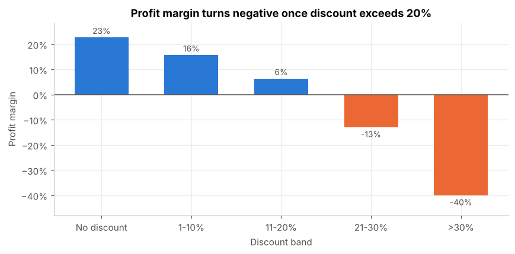

# 🛒 ShopKart Sales Performance Analysis (2024–2025)

An end-to-end data analyst project: **cleaning messy data → SQL analysis → Python EDA → dashboard → business recommendations**
for an Indian online retailer.

**Skills shown:** Data cleaning (pandas) · SQL (CTEs, window functions, CASE, subqueries) · Exploratory data analysis ·
Data visualisation (matplotlib/seaborn) · Power BI / Excel dashboarding · Turning numbers into business recommendations

---

## 📌 Business problem
ShopKart sells Electronics, Fashion, Home & Kitchen, Furniture, Beauty and Sports products in 15 Indian cities.
Revenue grew in 2025, but leadership feels **profit is not keeping pace**. The Head of Sales wants to know:

1. How are revenue and profit trending? Is there seasonality?
2. Which categories and products actually make money?
3. Are discounts helping or hurting?
4. Which regions and cities are growing fastest?
5. Where are we losing revenue to returns and cancellations, and why?
6. Who are our customers, and how concentrated is revenue?

## 🗂️ Dataset
| | |
|---|---|
| Source | Synthetic data modelled on a real Indian e-commerce business (`scripts/generate_data.py`) |
| Period | Jan 2024 – Dec 2025 |
| Size | 10,892 raw rows → 10,717 clean rows, 20 raw columns → 33 after feature engineering |
| Grain | One row per order |

Key columns: `order_id, order_date, customer_id, gender, customer_age, city, state, region, product_name, category,
quantity, unit_price, unit_cost, discount_pct, payment_method, order_status, delivery_days, customer_rating`

## 🧹 Data cleaning (`scripts/clean_data.py`)
The raw file has the kinds of problems real company data has:

| Problem | Fix |
|---|---|
| 160 duplicate rows | Removed exact duplicates |
| 3 different date formats (`2024-03-05`, `05/03/2024`, `05-Mar-2024`) | Parsed each format and combined |
| City names like `" mumbai"`, `BANGALORE`, `Bengaluru` | Trimmed, title-cased, mapped Bengaluru → Bangalore |
| Prices stored as text (`₹1,499`) | Removed ₹ and commas, converted to numbers |
| Payment labels `upi`, `COD`, `CC` … | Mapped to 6 standard values |
| 107 missing regions | Filled from state (state decides region) |
| Quantity ≤ 0, ages like 0 / 150 / 999 | Dropped bad quantities; nulled bad ages, refilled from the same customer's other orders |
| — | Added `net_sales, profit, revenue (delivered only), discount_band, age_group, year_month` … |

## 📊 Key insights

| | |
|---|---|
| **Revenue** | ₹629 lakh over 2 years, **+21% YoY** |
| **Profit** | ₹75.6 lakh, **12.0% margin** |
| **Orders / customers** | 10,717 orders from 2,739 customers, AOV ₹6,641 |

1. **Electronics brings 64% of revenue but only 5% of profit** (1% margin). iPhone 15, HP Pavilion and Lenovo IdeaPad **lose money**.
   Fashion is 11% of revenue but **40% of profit**.
2. **Discounts above 20% destroy profit.** These orders (8.6% of all orders) lost **₹14.4 lakh**, almost all in Electronics.
   Margin falls from 23% (no discount) to −40% (>30% discount).
3. **Festive season drives the year.** October + November = **28% of annual revenue**; January is always the weakest month.
4. **South is the growth engine:** +30% YoY vs 15–18% for other regions. Mumbai, Delhi and Bangalore make up ~45% of revenue.
5. **Leakage:** ₹74 lakh (10.6% of order value) lost to returns and cancellations.
   - Fashion return rate **13.5%** (2–4× other categories)
   - Cash on Delivery cancel rate **11.4%** vs ~2–3% for prepaid
   - Deliveries taking **8+ days** are returned **2× as often** (14.9%) and rated lower (3.8 vs 4.3). East averages 6 days vs 4 elsewhere.
6. **Customers:** 73% are repeat buyers; the **top 20% generate ~70% of revenue**. The 25–34 age group is ~45% of revenue.





## ✅ Recommendations
1. **Cap Electronics discounts at ~10%**; sell higher-margin accessories and warranties alongside phones and laptops.
2. **Move festive deep discounts to Fashion & Beauty**, where 40–50% margins can absorb them.
3. **Plan for Oct–Nov:** stock, delivery capacity and ad budget should be in place by September.
4. **Invest in the South** (Bangalore, Hyderabad, Chennai) — more assortment and marketing.
5. **Reduce COD cancellations:** small discount for UPI/prepaid, plus order confirmation by SMS/call for COD.
6. **Cut Fashion returns:** size charts, fit reviews, and faster delivery in the East.
7. **Loyalty tier** for the top 20% of customers (early access to festive sales).

## 📁 Project structure
```
retail-sales-analysis/
├── data/
│   ├── raw/shopkart_sales_raw.csv          # messy source data
│   └── processed/
│       ├── shopkart_sales_clean.csv        # clean data (use this in Power BI / Excel)
│       ├── shopkart.db                     # SQLite database with table `orders`
│       └── cleaning_log.txt
├── notebooks/retail_sales_analysis.ipynb   # full EDA with charts and insights
├── sql/business_queries.sql                # 15 business questions in SQL
├── scripts/
│   ├── generate_data.py                    # creates the raw dataset
│   ├── clean_data.py                       # cleaning + feature engineering
│   ├── load_to_sqlite.py                   # loads DB and runs all SQL queries
│   └── build_notebook.py                   # rebuilds & executes the notebook
├── dashboard/powerbi_dashboard_guide.md    # step-by-step Power BI build (with DAX)
├── docs/
│   ├── sql_results.txt                     # output of every SQL query
│   └── interview_prep.md                   # how to present this project
└── images/                                 # charts used in README
```

## ▶️ How to run
```bash
pip install pandas numpy matplotlib seaborn
python scripts/generate_data.py      # optional – raw data is already included
python scripts/clean_data.py
python scripts/load_to_sqlite.py     # runs all 15 SQL queries
jupyter notebook notebooks/retail_sales_analysis.ipynb
```

## ⚠️ Limitations
- The data is synthetic (designed to behave like a real retailer), so the insights show the method, not a real company's results.
- No marketing spend, website traffic or shipping/return-handling costs, so profit is product-level only.
- Next steps: customer lifetime value, RFM segmentation, and a discount A/B test design.
